# Propuesta de rediseño UX/UI — Guías Coodescor

**Estado:** ✅ **implementado en el frontend React** (octubre 2026). Las maquetas
estáticas siguen en [`docs/ux-preview/`](ux-preview/) y el resultado real está en
la sección [11. Resultado implementado](#11-resultado-implementado).

**Decisión del usuario:** se aprobó el rediseño y se retiró el **porcentaje de
cumplimiento** del tablero, porque no es necesario para la operación.

---

## 1. Objetivo

Modernizar la experiencia para que el equipo opere **más rápido, con menos
errores y en cualquier dispositivo**, optimizando el espacio y el diseño sin
cambiar las reglas de negocio ni los flujos ya validados en QA.

Prioridades:

1. Que cada persona vea **qué tiene que hacer ahora** (enfoque “tarea primero”).
2. Que CEDIS y transportistas puedan operar **desde el celular** sin tablas
   diminutas.
3. Reducir pasos y decisiones por guía (crear, controlar, entregar).
4. Un lenguaje visual **moderno y consistente**, accesible y con modo oscuro.
5. Que el cambio sea **incremental y de bajo riesgo** (sin reescribir negocio).

---

## 2. Tendencias y referentes usados

La propuesta toma patrones vigentes en aplicaciones de operación y logística:

| Tendencia | Qué aporta aquí | Referencia |
|---|---|---|
| **Task-first / dashboard accionable** en lugar de “pantalla de datos” | El tablero abre con “Mi trabajo de hoy”: pendientes priorizados y el botón del siguiente paso | [Modern dashboard UI best practices 2025-2026](https://raw.githubusercontent.com/desplega-ai/agent-swarm/refs/heads/main/thoughts/taras/research/2026-02-25-dashboard-ui-design-best-practices.md) · [Dashboard UX principles](https://www.uxpin.com/studio/blog/dashboard-design-principles/) |
| **Tokens de diseño en OKLCH** y modo oscuro por capas | Mantener marca y contraste al cambiar de tema sin duplicar CSS | [shadcn/ui theming](https://ui.shadcn.com/docs/theming) · [Material 3 color roles](https://m3.material.io/styles/color/roles) |
| **Navegación lateral + búsqueda global tipo comando (⌘K)** en escritorio | Acceso directo a guías/clientes sin recorrer menús; espacio útil para la tabla | [Linear UI redesign](https://linear.app/now/how-we-redesigned-the-linear-ui) · [Vercel Geist](https://vercel.com/geist) |
| **Navegación inferior + tarjetas + acción principal fija** en móvil | Uso con una mano y dedos gruesos en bodega; sin tablas anchas | [ServiceTitan · optimizaciones móviles de campo](https://help.servicetitan.com/release-hub/docs/improve-the-tablet-experience-with-field-mobile-app-tablet-user-interface) |
| **Status pills/píldoras semánticas** en lugar de texto de estado | Estado legible de un vistazo, con color consistente en toda la app | [Carbon · Status indicator pattern](https://carbondesignsystem.com/patterns/status-indicator-pattern/) |
| **Asistentes por pasos y validación en línea** en formularios largos | Crear guía en 3 bloques, resumen siempre visible, borrador automático | [NN/g · Form design](https://www.nngroup.com/articles/web-form-design/) |
| **Objetivos táctiles ≥ 24 px (ideal 44 px) y foco visible** | Operación con guantes/celular y accesibilidad | [WCAG 2.2 · Target Size (Minimum)](https://www.w3.org/WAI/WCAG22/Understanding/target-size-minimum.html) |
| **Confirmación del cliente sin fricción** (link/POD) | El cliente firma desde el celular sin cuenta; estado claro para la operación | [FarEye · delivery experience](https://fareye.com/resources/product-release/fareye-product-enhancements-sept-2025) |

> No se trata de “copiar” una app: se adoptan los patrones que ya usa el sector
> logístico para reducir tiempos de captura y errores de digitación.

---

## 3. Diagnóstico de la interfaz actual (React)

Revisión del código y de los estilos actuales
([`global.css`](../frontend/src/styles/global.css), páginas y componentes):

| # | Hallazgo | Impacto |
|---|---|---|
| D1 | El layout es “header + contenido”, sin navegación persistente ni búsqueda global | Cada cambio de sección cuesta clics; el espacio horizontal se desaprovecha |
| D2 | El tablero muestra primero conteos y una tabla; las **tareas del rol** no están priorizadas | El usuario debe interpretar qué hacer; CEDIS pierde tiempo decidiendo |
| D3 | Tabla ancha también en móvil | Scroll horizontal, filas ilegibles y acciones diminutas |
| D4 | Acciones con `alert()`/`confirm()` nativos | Ruptura visual, bloqueo del flujo, mala experiencia en móvil |
| D5 | Guardar/validar sin *skeletons* ni estados de carga claros | Sensación de lentitud y doble clic |
| D6 | Formulario de guía largo en una sola página | Errores detectados tarde y pérdida de datos si se recarga |
| D7 | Firmas y pasos de CEDIS dentro de formularios densos | Difícil firmar en pantalla pequeña; riesgo de omitir un campo |
| D8 | Modo oscuro solo por preferencia del sistema y con contraste manual | Inconsistencias y poco control del usuario |
| D9 | Tipografía/espaciado variables; mezcla de estilos por página | Menor sensación de producto terminado |
| D10 | Sin atajos, sin búsqueda por NIT/placa, filtros poco visibles | Tareas repetitivas más lentas |

> Varias correcciones funcionales ya están hechas (QA): alertas reales de error,
> notificaciones, permisos y firma de practicante. Esta propuesta es **visual y
> de interacción**, no cambia reglas de negocio.

---

## 4. Sistema de diseño propuesto

### 4.1 Principios

1. **Claridad antes que densidad**: menos datos por pantalla, más jerarquía.
2. **Una acción principal por contexto** (botón primario visible y contextual).
3. **Consistencia semántica**: mismo color/forma para el mismo estado en toda la app.
4. **Progresivo**: lo avanzado (auditoría, configuración) se revela bajo demanda.
5. **Mobile-first en campo** (CEDIS y transportista), **desktop-first en gestión**
   (Ventas/Admin).
6. **Accesible por defecto**: foco visible, etiquetas, contraste AA, objetivos táctiles.

### 4.2 Fundamentos visuales

| Elemento | Propuesta |
|---|---|
| **Color primario** | Índigo `#4f46e5` (interactivo/selección). Alternativa: azul Coodescor `#1d4ed8`. |
| **Neutros** | Fondo `#f4f5f9`, superficie `#ffffff`, bordes `#e5e8f0`, texto `#0f172a`, secundario `#5b6577`. |
| **Estados** | Creada ámbar · Recibida azul · En CEDIS violeta · En ruta índigo · Entregada verde · Anulada gris. |
| **Modo oscuro** | Capas `#0b0f19` → `#111827` → `#151d2e`, sin negro puro; acento `#818cf8`. |
| **Tipografía** | Inter (o Segoe UI Variable); jerarquía 23/15/13/12/11; números tabulares. |
| **Espaciado** | Base 4 px; padding de página 24/26 px; tarjetas 14–16 px; gap 12–16 px. |
| **Radios** | 8 (controles), 12 (tarjetas internas), 16 (paneles), 999 (píldoras). |
| **Sombras** | Muy sutiles (1–3 px) en reposo; elevación solo en foco/hover. |
| **Iconografía** | Línea 1.8 px, 18/20 px, mismo set en toda la app. |
| **Movimiento** | 120–180 ms; respeta `prefers-reduced-motion`. |

### 4.3 Componentes a construir

`AppShell` (sidebar + topbar + búsqueda ⌘K), `PageHeader`, `KpiCard`,
`TaskCard`, `StatusPill`, `DataTable` (responsive → `GuiaCard`), `FilterBar`,
`Stepper`, `ActionPanel` (sticky), `SignaturePad` (pantalla completa en móvil),
`Wizard`, `Toast`, `Modal`, `EmptyState`, `Skeleton`, `Timeline`,
`ConfirmDialog`, `RoleBadge`, `CommandPalette`.

---

## 5. Pantallas propuestas (maquetas)

### 5.1 Tablero / Mi jornada — escritorio

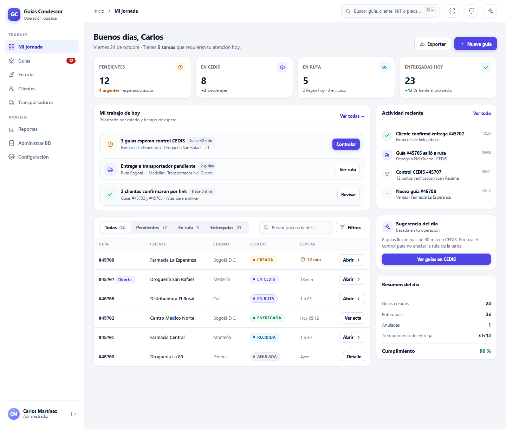

- Sidebar persistente con secciones por rol y contador de pendientes.
- Encabezado con saludo operativo, **fecha y tareas del día**.
- Cuatro KPIs accionables (clic → lista filtrada).
- **“Mi trabajo de hoy”**: 3 tareas priorizadas con botón directo (“Controlar”,
  “Ver ruta”, “Revisar”).
- Tabla compacta con guía, cliente, ciudad, **estado**, **tiempo de espera** y
  acción; pestañas *Todas / Pendientes / En ruta / Entregadas*.
- Rail derecho: actividad reciente, sugerencia contextual y resumen del día.

### 5.2 Modo oscuro

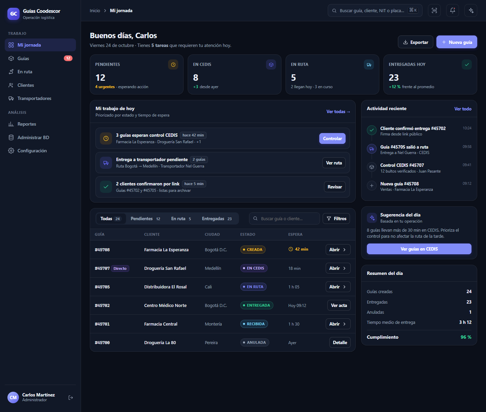

Mismo layout con tokens de tema; útil para turnos nocturnos y pantallas de CEDIS.
Se activa desde el perfil (Auto / Claro / Oscuro) y se recuerda por usuario.

### 5.3 Tablero móvil

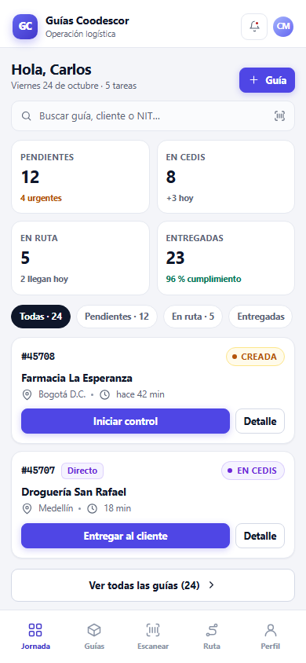

- **Navegación inferior** (Jornada · Guías · Escanear · Ruta · Perfil) y botón
  “+ Guía” al alcance del pulgar.
- KPIs en 2×2, filtros en chips horizontales y **tarjetas** con la acción
  principal visible (“Iniciar control”, “Entregar al cliente”).
- Búsqueda fija y acceso a escáner QR/código de barras (PWA).

### 5.4 Detalle de guía — escritorio

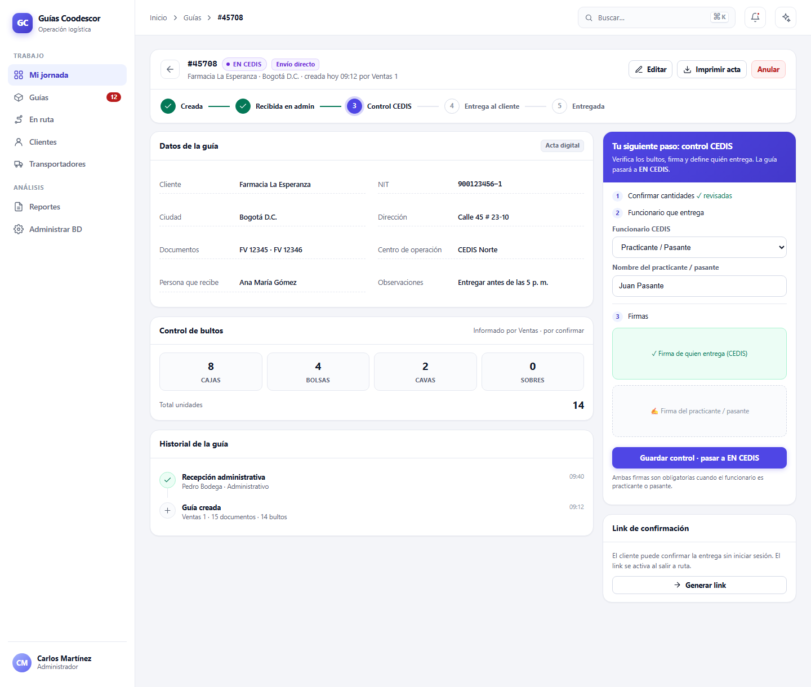

- Cabecera con consecutivo, estado, tipo de flujo y acciones (editar, imprimir, anular).
- **Stepper horizontal** con el paso actual y lo que falta.
- Datos, bultos e historial en una sola columna legible.
- **Panel de acción sticky** con el siguiente paso, incluido el flujo de
  **practicante/pasante** (nombre + ambas firmas), como se implementó en esta QA.
- Link de confirmación del cliente a un clic.

### 5.5 Nueva guía — asistente en 3 pasos

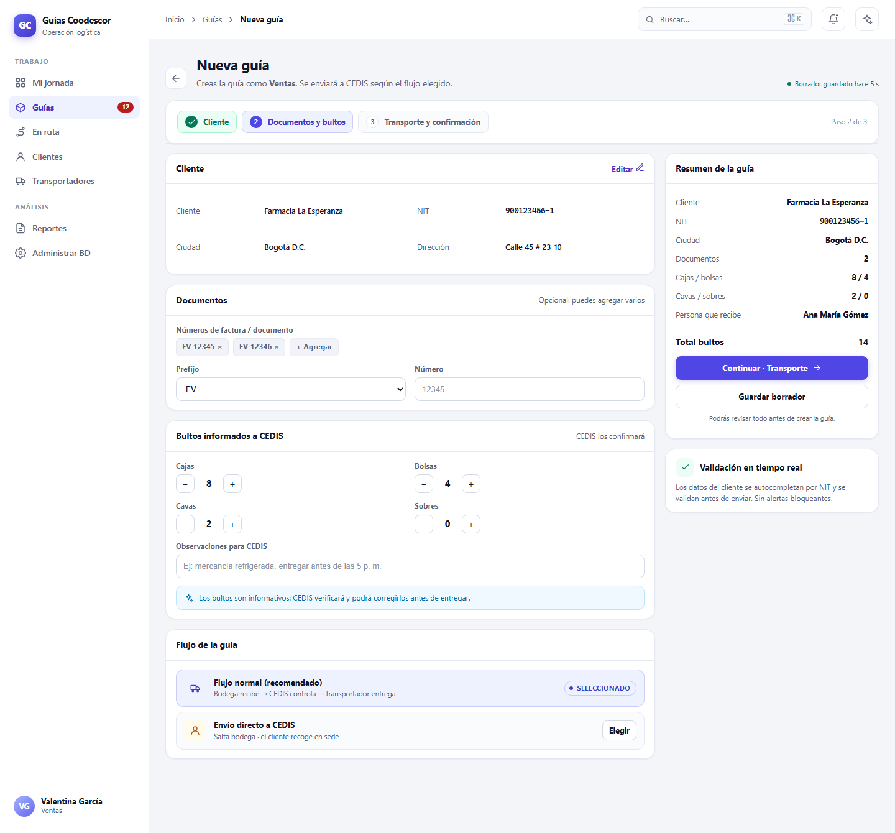

1. **Cliente** (autocompletado por NIT, datos precargados).
2. **Documentos y bultos** (chips de facturas, contadores grandes, observaciones).
3. **Transporte y confirmación** (flujo normal vs. envío directo + resumen).

Siempre visible: resumen lateral, total de bultos y **borrador guardado**
automáticamente. Validación en línea (sin alertas bloqueantes).

### 5.6 Control CEDIS — móvil

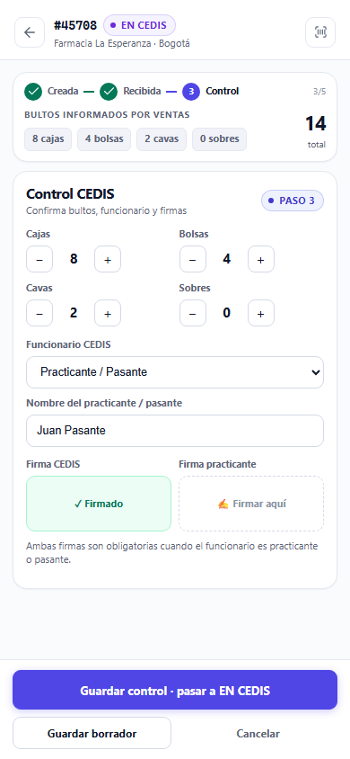

Pantalla dedicada al paso: resumen de bultos, contadores táctiles, selector de
funcionario (incluye practicante/pasante), nombre y **firmas lado a lado** con
acción fija inferior. Pensada para operar de pie y con una mano.

### 5.7 Inicio de sesión

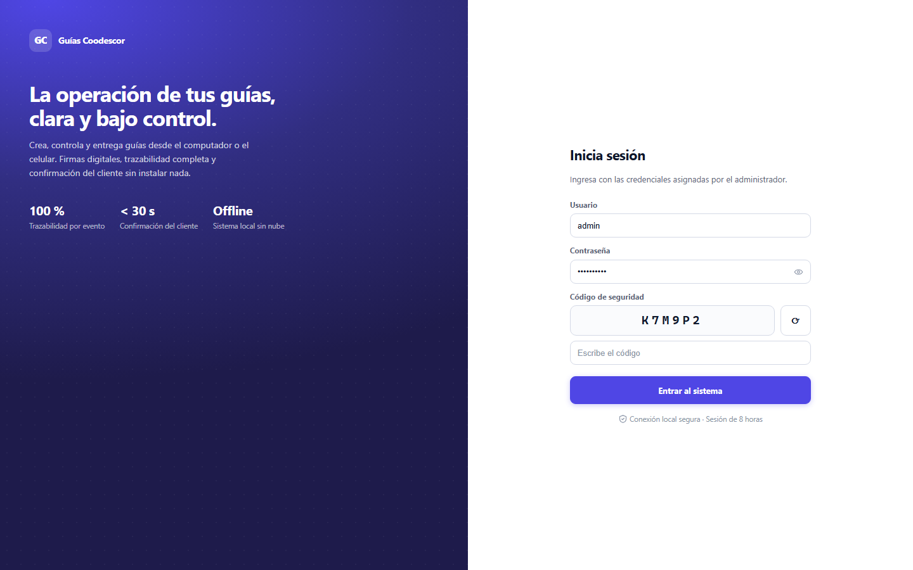

- Panel de marca con beneficios (trazabilidad, confirmación rápida, sistema local).
- Formulario limpio, CAPTCHA claro y mensajes de error junto al campo.

---

## 6. Cómo se optimiza el espacio

| Antes | Después |
|---|---|
| Header + tabla a todo el ancho | Sidebar 240 px + contenido con rail de 344 px: más contexto sin perder la tabla |
| Conteos sueltos en chips | KPIs + pestañas + filtros en una sola franja |
| Tabla con 6+ columnas en móvil | Tarjetas de 3 líneas con acción principal y metadatos esenciales |
| Formulario largo con secciones apiladas | Wizard con resumen fijo: el usuario ve el total mientras llena |
| Firmas dentro de formularios largos | Panel/pantalla dedicada con canvas amplio y guardado fijo |
| Texto de estado | Píldoras de estado consistentes (color + punto + etiqueta) |

---

## 7. Accesibilidad y calidad

- Contraste **AA** (mínimo 4.5:1 en texto; 3:1 en UI) en claro y oscuro.
- Objetivos táctiles ≥ **44×44 px** en móvil (mínimo WCAG 2.2: 24 px).
- Etiquetas visibles y `aria-label` en iconos; foco visible con anillo índigo.
- Navegación completa por teclado; `Esc` cierra modales; `⌘K` abre búsqueda.
- `prefers-reduced-motion` respetado; sin animaciones que bloqueen.
- Estados vacíos, de carga (skeleton) y de error explícitos.
- Textos en español claro; fechas y números con formato colombiano.

---

## 8. Plan de implementación propuesto (incremental, sin romper negocio)

| Fase | Alcance | Riesgo | Resultado visible |
|---|---|---|---|
| **F1 · Fundación** (2–3 días) | Tokens CSS, tipografía, componentes base (`Button`, `Card`, `StatusPill`, `Field`), tema claro/oscuro | Bajo | Toda la app usa el mismo lenguaje visual |
| **F2 · Shell + tablero** (3–4 días) | Sidebar, topbar, búsqueda, KPIs, “Mi trabajo de hoy”, tabla/cards responsivas | Medio | Nueva pantalla principal para todos los roles |
| **F3 · Detalle + CEDIS móvil** (3–4 días) | Stepper, panel sticky, signature pad ampliado, pantalla de control móvil | Medio | CEDIS opera más rápido y sin errores |
| **F4 · Nueva guía** (2–3 días) | Wizard 3 pasos, resumen, borrador, validación en línea | Medio | Menos errores al crear y menos tiempo |
| **F5 · Pulido** (2 días) | Toasts, skeletons, modales, empty states, atajos, a11y, pruebas | Bajo | Sensación de producto terminado |

**Total estimado:** 12–16 días de desarrollo + pruebas. Se puede entregar por
fases: cada fase es utilizable y no bloquea la operación.

**Estrategia técnica sugerida:** mantener el backend y los endpoints actuales;
reemplazar progresivamente los estilos por tokens y componentes compartidos.
No se requiere migrar datos ni cambiar permisos.

---

## 9. Decisiones aplicadas

1. **Color de marca:** índigo `#4f46e5`.
2. **Navegación:** sidebar en escritorio + barra inferior en móvil.
3. **Tema:** claro por defecto, con selector claro/oscuro persistido por usuario.
4. **Alcance:** fases F1–F4 implementadas en el frontend React.
5. **Densidad:** cómoda, con adaptación a móvil.
6. **Marca:** “Guías Coodescor”.

---

## 10. Cómo revisar las maquetas

- Galería: [`docs/ux-preview/index.html`](ux-preview/index.html)
- Maquetas: [`docs/ux-preview/png/`](ux-preview/png/) (`01` a `07`).
- Capturas reales de la implementación: [`docs/ux-preview/png/`](ux-preview/png/)
  (`real-*.png`).
- Las maquetas son **HTML estático** con datos ficticios; las capturas `real-*`
  se tomaron con la app en ejecución y datos de prueba.

---

## 11. Resultado implementado

El rediseño se integró en el **frontend React** (`frontend/`). No se modificaron
la base de datos, los endpoints ni las reglas de negocio; los flujos validados en
QA se mantienen.

### 11.1 Capturas reales de la app

| Pantalla | Captura |
|---|---|
| Tablero (claro) | 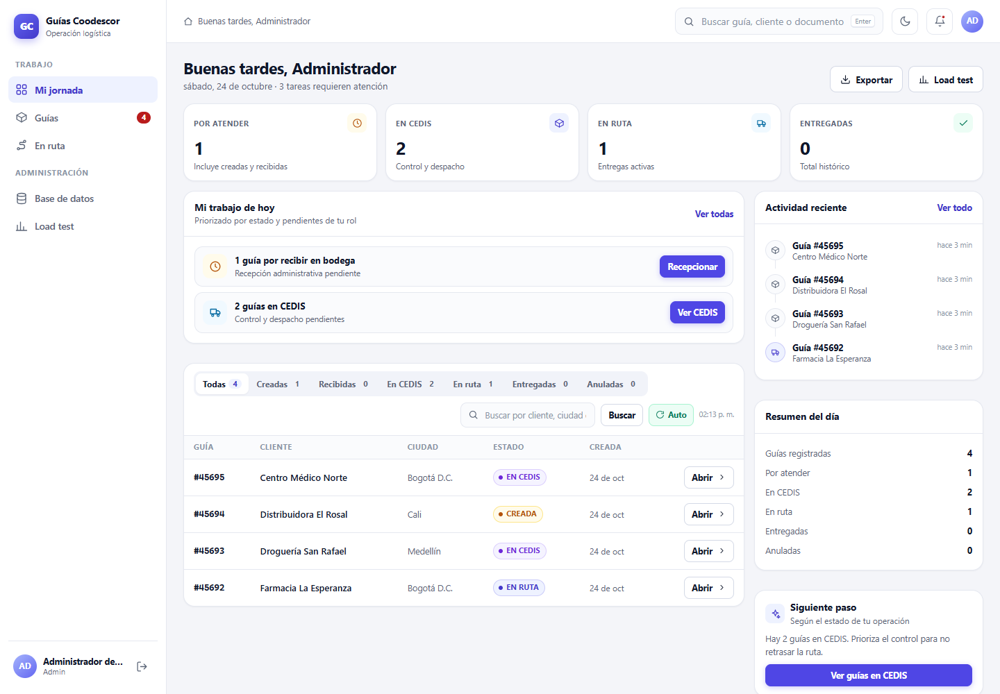 |
| Tablero (oscuro) | 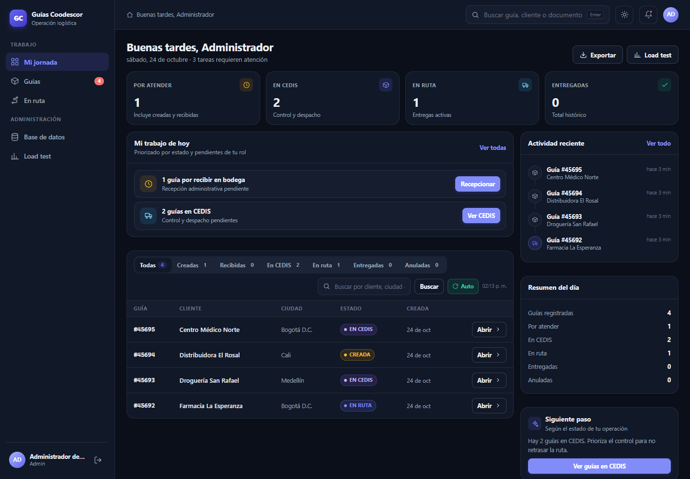 |
| Detalle de guía | 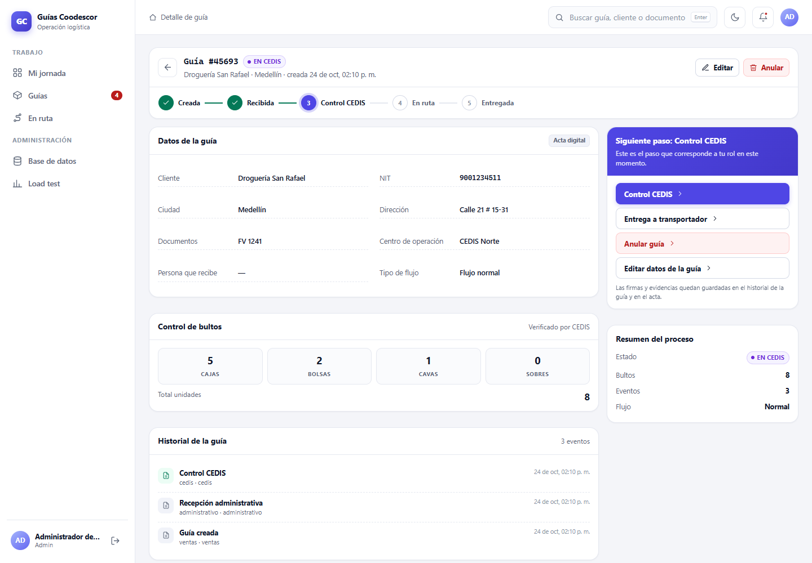 |
| Tablero móvil | 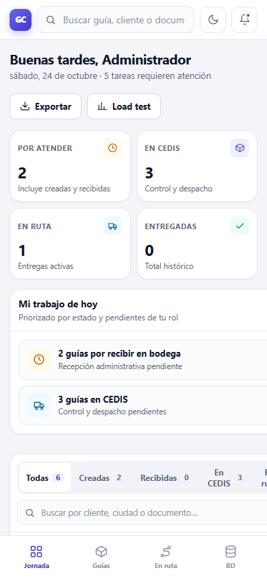 |
| Detalle móvil | 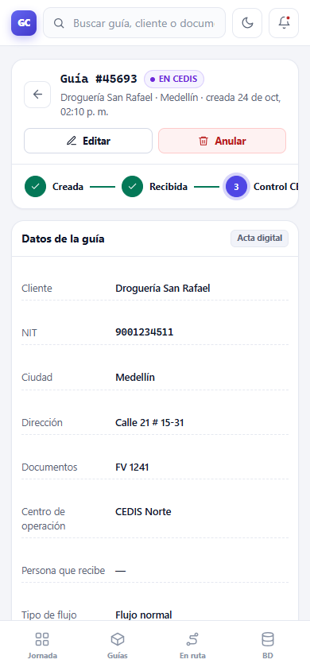 |
| Guías (vista propia) | 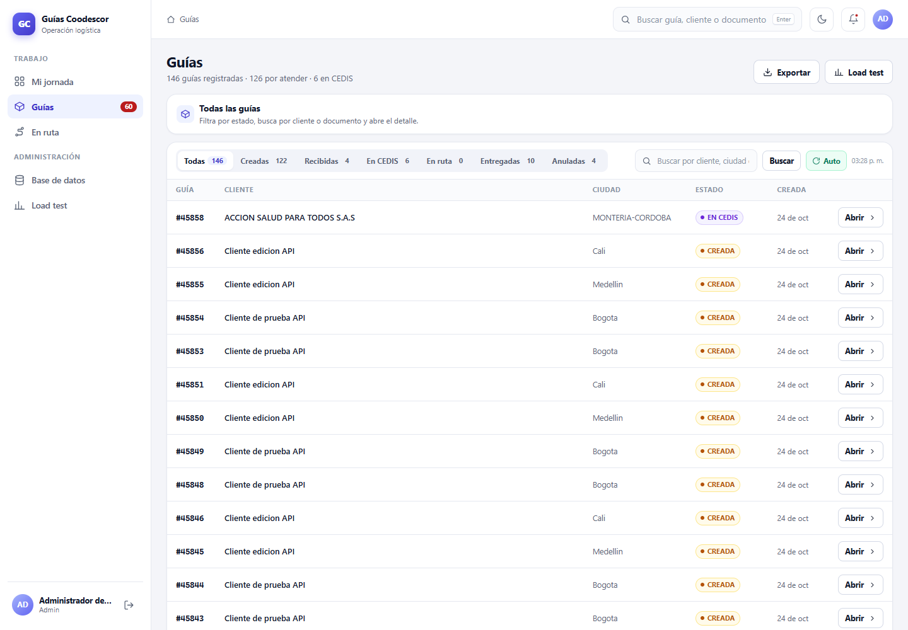 |
| En ruta (vista propia) | 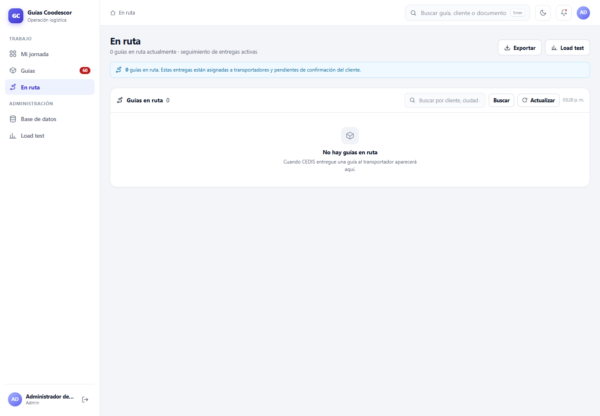 |
| Nueva guía (paso 1) | 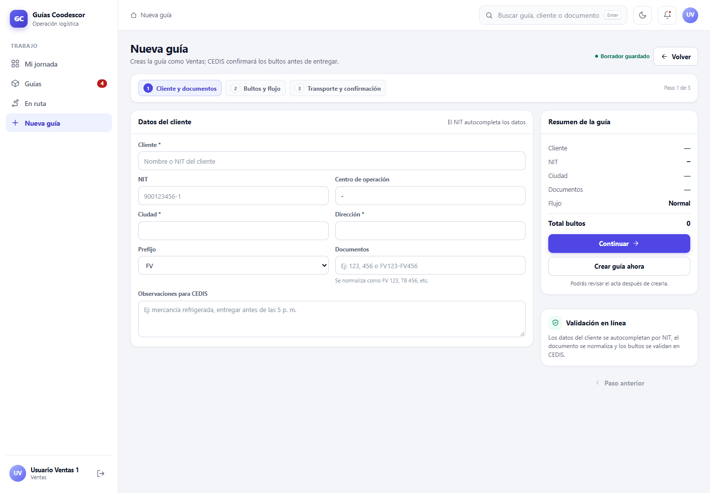 |
| Nueva guía (paso 2) | 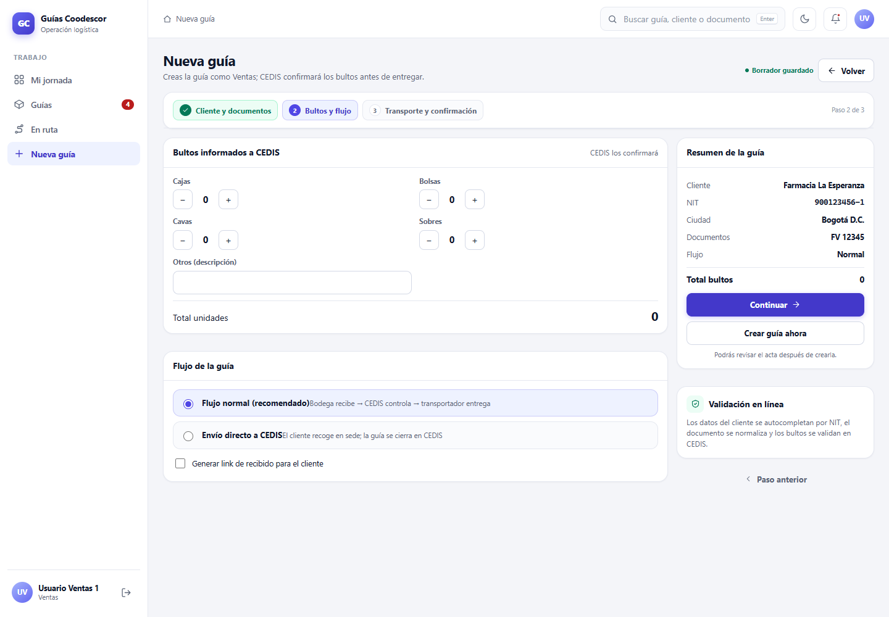 |
| Login | 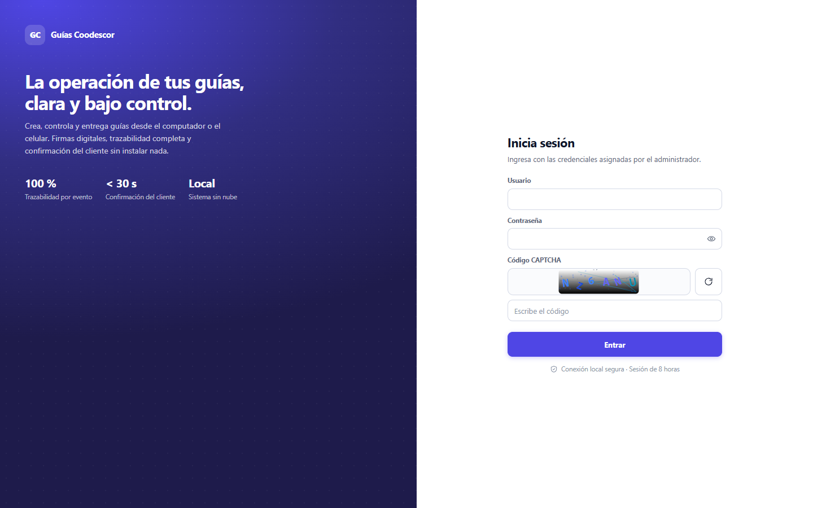 |

### 11.2 Qué se implementó

- **Sistema de diseño** (`frontend/src/styles/global.css`): tokens claros/oscuros,
  tipografía, botones, formularios, píldoras de estado, tablas, KPIs, timeline y
  utilidades responsive.
- **Shell de aplicación** (`components/AppShell.jsx`): sidebar por rol, topbar con
  búsqueda, campana de notificaciones, selector de tema y barra inferior en móvil.
  Cada opción abre una **vista distinta**: **Mi jornada** (resumen y tareas),
  **Guías** (listado completo con filtros) y **En ruta** (solo entregas activas).
  Iconografía propia en `components/Icon.jsx` y componentes compartidos en
  `components/ui.jsx`.
- **Tablero** (`pages/Tablero.jsx`): saludo operativo, KPIs accionables, “Mi trabajo
  de hoy”, pestañas por estado con contadores, búsqueda, actualización automática,
  tabla de escritorio y tarjetas en móvil, rail de actividad/resumen. **Sin
  porcentaje de cumplimiento.**
- **Detalle de guía** (`pages/DetalleGuia.jsx`): cabecera con estado, stepper del
  proceso, datos y bultos, historial y panel lateral con el siguiente paso. Las
  firmas se dibujan en un canvas amplio; se mantiene la validación de
  **practicante/pasante con nombre y firma propia** y la **doble firma del
  transportador** al entregar al cliente. CEDIS dispone además de la acción
  **“Capturar datos de quien reclama”** (nombre, cédula, teléfono y firma) que
  registra un evento sin cambiar el estado ni cerrar la guía.
- **Nueva guía** (`pages/NuevaGuia.jsx`): asistente de 3 pasos (cliente y
  documentos → bultos y flujo → transporte y confirmación), resumen fijo, borrador
  automático y validación en línea. Los documentos se agregan por filas con su
  propio prefijo (**+ Agregar documento**) y se envían como `documentos_json`.
  El cliente se autocompleta por **nombre o NIT** y, si viene a recoger, se puede
  habilitar la **captura de la persona que reclama** (nombre, cédula, teléfono y
  firma) sin cerrar la guía.
- **Login** (`pages/LoginPage.jsx`): diseño de dos paneles con el formulario en el
  **70 % del ancho** (30 % para la marca), CAPTCHA grande y legible, mostrar/ocultar
  contraseña y mensajes de error accesibles. El SVG del CAPTCHA se rediseñó con
  fondo claro, letras más grandes y menos ruido visual (`captcha_service.py`).
- **Tema claro/oscuro** persistido en `localStorage` y aplicado antes del primer
  render (`main.jsx`).
- **Servido desde el backend**: el build de React (`frontend/dist`) se sirve en
  `http://localhost:8000` para `/login`, `/tablero`, `/guia/<id>`, `/nueva-guia`,
  `/admin/db` y `/admin/loadtest`, con `/assets/*` y fallback SPA. Así ngrok y los
  scripts de arranque usan la interfaz nueva sin depender de Vite.
- **Caché/PWA**: el service worker anterior se sustituyó por uno que borra las
  cachés y se desregistra; el index se sirve con `no-store` para que un
  despliegue nuevo se vea al recargar.
- **Correcciones encontradas al probar**:
  - el interceptor 401 recargaba `/login` en bucle cuando no había sesión;
  - el proxy de Vite cambiaba el `Host` y el backend rechazaba el CAPTCHA con 403
    por validación de origen (CSRF). Ambos quedaron corregidos.

### 11.3 Verificación

- **Backend:** `178 passed, 4 subtests` (sin cambios de negocio).
- **Playwright E2E:** `6 passed` (login, sesión, búsqueda, creación de guía y
  administración) usando Chrome del sistema.
- **Build de producción:** correcto (`vite build`).
- **Lint:** 0 errores (solo advertencias del compilador de React).
- **Prueba manual automatizada:** control CEDIS con practicante/pasante y dos
  firmas → evento guardado con `firma_practicante_archivo` y guía en `EN_CEDIS`.

### 11.4 Alcance y siguiente paso

La interfaz nueva se sirve **desde el propio backend** en `http://localhost:8000`
(usa el build de `frontend/dist`), por lo que también es la que ven ngrok y los
scripts de arranque de Windows. Vite (`5173`) queda solo para desarrollo. El
service worker de la PWA anterior se reemplazó por un limpiador que borra cachés
y se desregistra, para que no vuelva a mostrarse la pantalla vieja.

De la interfaz heredada solo quedan las páginas que no son aplicación: el acta
imprimible y la firma pública del cliente (`/firma/<token>`). El resto de rutas
de entrada ya carga la SPA React.

Siguiente paso sugerido: revisar la app en ejecución con el equipo y, si se
aprueba, añadir pruebas E2E del flujo completo CEDIS y modernizar las pantallas
de administración que aún usan componentes visuales anteriores.

